 

 

## About

I build full-stack applications and AI-powered products that turn practical ideas into usable software — from interfaces and APIs to data, machine learning, and the product thinking that ties them together.

Computer Science & Engineering at **Rajalakshmi Engineering College**, with client work shipped to production alongside my projects.

<table>
<tr>
<td width="25%" valign="top">

**Full-Stack** 
Complete web applications across frontend, backend, APIs, and databases.

</td>
<td width="25%" valign="top">

**AI & ML** 
Practical machine learning with explainability built in, not bolted on.

</td>
<td width="25%" valign="top">

**Data & Analytics** 
Turning raw data into dashboards, insight, and decisions.

</td>
<td width="25%" valign="top">

**Product** 
Responsive, intuitive experiences designed around real user needs.

</td>
</tr>
</table>

 

## Tech Stack

  

  
  
  
  
  
  
  
  
  
  

 

## Featured Projects

<table>
<tr>
<td width="22%" valign="top"><b>GGE</b> Golden Globe Enterprises  CLIENT / PRODUCTION</td>
<td valign="top">
Production financial services website built and shipped for a real client, with a responsive interface and a focused black, gold, and white visual system.  
<code>React</code> <code>Tailwind CSS</code> <code>JavaScript</code>  
<a href="https://gge-website-eosin.vercel.app"><b>Live Site</b></a> &nbsp;·&nbsp; <a href="https://github.com/subha-0306/gge-website">Repository</a>
</td>
</tr>
<tr>
<td valign="top"><b>WalletWise</b> Personal finance PWA  FULL-STACK</td>
<td valign="top">
Mobile-first, installable finance app: multi-wallet tracking, borrow and lend with linked transactions, recurring transactions, budgets, savings goals, and spending analytics.  
<code>React</code> <code>Vite</code> <code>Tailwind CSS</code> <code>Express</code> <code>Supabase</code> <code>PostgreSQL</code>  
<a href="https://wallet-wise-tawny.vercel.app"><b>Live Demo</b></a> &nbsp;·&nbsp; <a href="https://github.com/subha-0306/WalletWise">Repository</a>
</td>
</tr>
<tr>
<td valign="top"><b>GrowLedger AI</b> Explainable financial readiness  AI / ML</td>
<td valign="top">
Financial readiness assessment that pairs a LightGBM model with TreeSHAP explanations, then turns the result into a Financial Passport, a plain-language story, and a 30 / 60 / 90-day roadmap.  
<code>React</code> <code>Vite</code> <code>Flask</code> <code>LightGBM</code> <code>TreeSHAP</code>  
<a href="https://growledger-ai.vercel.app"><b>Live Demo</b></a> &nbsp;·&nbsp; <a href="https://github.com/subha-0306/GrowLedger-AI">Repository</a>
</td>
</tr>
<tr>
<td valign="top"><b>S.P.E.A.K. AI</b> Women's safety platform  FULL-STACK / AI</td>
<td valign="top">
Anonymous incident reporting with AI-assisted severity analysis, an interactive safety map, SOS support, and a live safety dashboard.  
<code>React 18</code> <code>Flask</code> <code>React Leaflet</code> <code>Chart.js</code>  
<a href="https://github.com/subha-0306/SPEAK_Project">Repository</a>
</td>
</tr>
<tr>
<td valign="top"><b>TrustCharge</b> EV charging analytics  DATA</td>
<td valign="top">
Analytics dashboard for evaluating EV charging station trust, performance, and related data-driven insights.  
<code>Python</code> <code>Streamlit</code> <code>Data Analytics</code>  
<a href="https://github.com/subha-0306/TrustCharge">Repository</a>
</td>
</tr>
</table>

 

## GitHub Activity

  
  

  

  

<picture>
  <source media="(prefers-color-scheme: dark)" srcset="https://raw.githubusercontent.com/subha-0306/subha-0306/output/github-snake-dark.svg">
  <source media="(prefers-color-scheme: light)" srcset="https://raw.githubusercontent.com/subha-0306/subha-0306/output/github-snake.svg">
  
</picture>

 

Building in public from Chennai, India.

